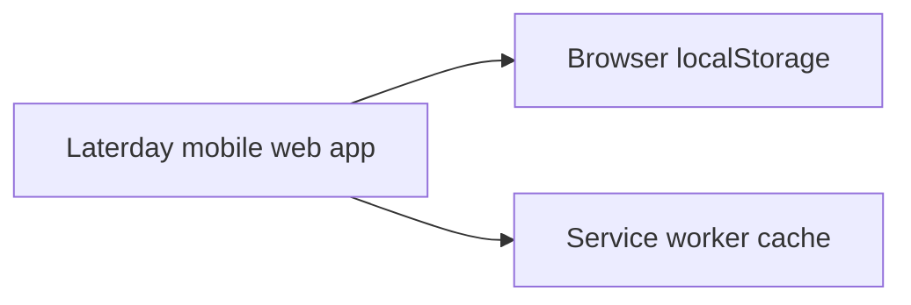

# Laterday

Laterday is a quiet, local-first save-for-later inbox for notes, links, and images. This project completes **Stage 1**: one device, no account, no backend.

## Run it

The app is a static progressive web app. Serve this folder from a local HTTP server (service workers and install prompts need HTTP or HTTPS):

```powershell
py -m http.server 8000
```

Open `http://localhost:8000` on a computer, or open the same address from a phone on the same Wi-Fi using your computer's LAN IP. For phone installation, host the folder on any static HTTPS host and choose **Add to Home Screen** in the browser. There is no build step or dependency installation.

## What’s here

- Save and edit notes, links, and images; add comma-separated tags.
- Search across titles, text, links, and tags; filter by type or tag; sort by date or title.
- Open a detail view, favorite saves, archive and restore them, or delete them.
- Data persists in browser `localStorage`; uploaded images are stored as data URLs. The app shell is cached for offline launch after the first visit.
- Responsive mobile layout, optional dark mode, and installable PWA manifest.

## Architecture



Saved items have an ID, type, title, text/link/image content, tags, created and updated timestamps, favorite state, and archived state. No information is sent to a Laterday server. Opening a saved URL navigates to that external website.

## Important decisions and known limits

- LocalStorage keeps setup simple, but it is limited in capacity and tied to this browser profile. There is no cross-device sync or automatic backup. Large image files are capped at 5 MB; browser storage limits may be lower than the theoretical maximum.
- Deletion is permanent. Archiving is reversible.
- The type selector cycles through all types; the service-worker offline cache requires the app to be opened over HTTP(S) at least once. The serif and sans-serif typefaces load from Google Fonts when online and fall back to system fonts offline.
- This is a static web app rather than a native APK. It can be installed from a secure static host or run locally in a mobile browser.
